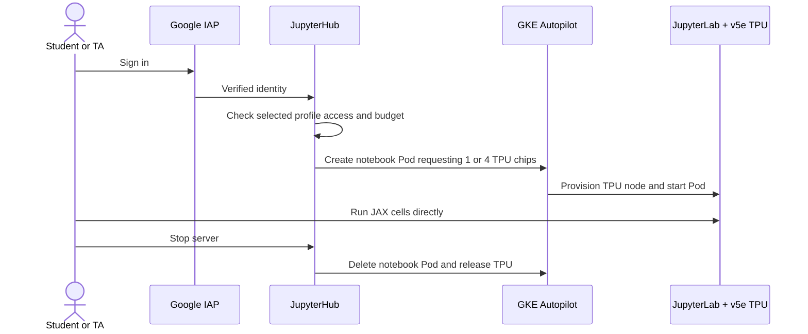

# Direct TPU notebook architecture

Google IAP admits the course groups. JupyterHub checks profile access and creates one JupyterLab Pod per user with one or four v5e chips. The user's 32 GiB home PVC persists when the Pod stops.

## Access and isolation

- IAP controls Hub access; `ADMIN_USERS` grants administration. config.env enables profiles, and **Admin → Notebook access** controls per-user four-chip grants. Both the picker and spawn path enforce access. See [advanced notebooks](advanced_notebooks.md).
- Notebook Pods use GKE Sandbox (`runtimeClassName: gvisor`) and the JupyterHub NetworkPolicy. Private cluster addresses and the cloud metadata server stay blocked.
- Notebook Pods do not receive Job submission RBAC or a mounted Kubernetes API token. JAX executes inside the notebook Pod on its attached TPU.
- The namespace ResourceQuota caps simultaneous TPU requests through `requests.google.com/tpu`. This is a hard limit, not a queue. Regional quota and available physical capacity are also required.

## Lifetime and costs

All attached chips are allocated while their notebook Pod exists, including idle periods. JupyterHub culls idle servers after 30 minutes and all servers after eight hours. A stopped server releases its TPU; the home PVC remains. The ResourceQuota and idle culler are the main capacity and cost controls.

The earlier Kueue and `submit_tpu.py` batch prototype remains in the repository for development. It is not installed by `make cluster`, mounted into notebook Pods, or used by the current starter notebook.
